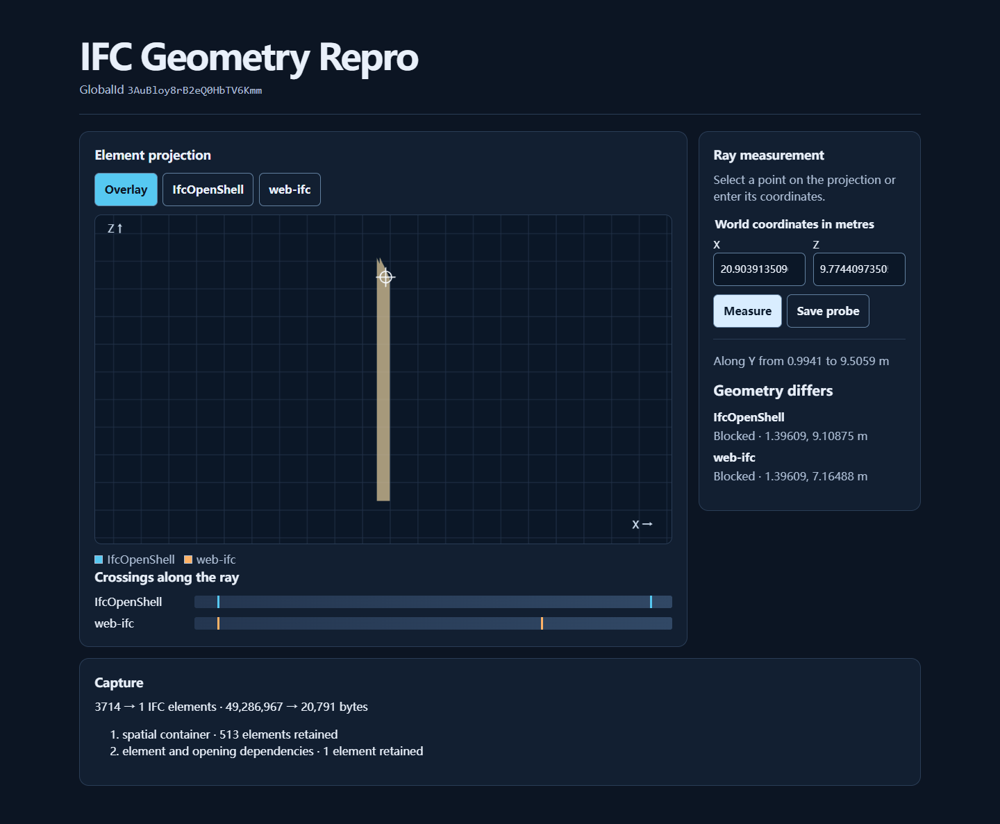

# IFC Geometry Repro

Capture a local geometry disagreement from one IFC file. Compare IfcOpenShell and web-ifc, pick a measurement point, and export a smaller IFC that still reproduces the same surface crossings. The program and reports run on your machine.

[中文说明](README.zh-CN.md) · [Data attribution](fixtures/NOTICE.md) · [Release notes](CHANGELOG.md)

## Open Agentic Web Challenge edition

Open the [public browser replay](https://aevumworks.github.io/ifc-geometry-repro/) and choose **Replay the discrepancy**. The agent delegates to its geometry agent, which calls the site's measurement and provenance actions. **Verify both controls** checks an opening and a solid point on the same buildingSMART wall. Both runs work without a login or model key.

The browser checks the IFC's SHA-256 and builds the web-ifc geometry in a Web Worker. IfcOpenShell supplies a mesh generated from the same fixture at build time. Both crossing calculations run in the browser. Pick a point or enter coordinates to measure a different ray, then download the result as JSON. The browser replays a published subset. Use the CLI for original-size models, new captures, or a completely fresh run of both geometry engines.

The site publishes its [agent manifest](https://aevumworks.github.io/ifc-geometry-repro/agent-manifest.json), [network](https://aevumworks.github.io/ifc-geometry-repro/ifc_geometry.network.json), [link map](https://aevumworks.github.io/ifc-geometry-repro/links.json), and browser runtime under the same HTTPS site base. The two no-key workflows use a deterministic planner. The optional **Use your own model** form runs the same graph with a tool-capable, browser-CORS-enabled OpenAI-compatible router. The key is held in the tab and goes to the selected router in its authorization header. The graph's local site actions require the fixture website. A peer can discover the network and use the public replay link for those actions.

Build and serve the website after `npm ci`:

```sh
node scripts/build_web.mjs
node scripts/serve_web.mjs
```

The replay is then available at `http://127.0.0.1:4173/`. To regenerate the archived meshes after installing the pinned Python dependencies, run `uv run --locked python -m scripts.export_web_evidence`.

The browser runtime is the unmodified Apache-2.0 reference copy at the [challenge's opening snapshot](https://github.com/cognizant-ai-labs/agentic-web/tree/e4a8727d5c6807233b8976f28494bbdac7bc1c6e/skills/agentify-website/runtime). Its license is in [web/runtime/LICENSE.txt](web/runtime/LICENSE.txt). web-ifc is shipped with its own license. IFC fixtures and derived mesh data follow the [fixture attribution](fixtures/NOTICE.md).



## Try the included case

Open [fixtures/schependomlaan/report.html](fixtures/schependomlaan/report.html) from your local checkout in a modern browser. The report loads without a server or an internet connection. It shows two different crossing positions for an exterior roof knee wall in the public Schependomlaan building model.

The source model has **3,714 IFC elements** and is 49,286,967 bytes. The captured subset has **one IFC element** and is 20,791 bytes. The two engines give the same readings on the full model and the reduced case. The deeper crossing is approximately **9.10875 m** in IfcOpenShell and **7.16488 m** in web-ifc. This documents disagreement at the selected ray. The case has no independent geometric ground truth.

## Install

Use Python 3.12 or 3.13, Node.js 20 or later, and [uv](https://docs.astral.sh/uv/). Run these commands from the repository root.

```sh
npm ci
uv sync --locked
uv run --locked python -m ifc_repro replay fixtures/schependomlaan
uv run --locked python -m pytest -q
```

The replay exits with 0 when the recorded disagreement reproduces, 1 when it does not, and 2 for an invalid input or an unavailable engine. The project locks IfcOpenShell 0.8.5 and web-ifc 0.0.77 to preserve the historical case. It also records the engine versions and checks the IFC byte hash at replay time.

## Capture your own case

1. List walls and find the element's GlobalId. Other represented IFC products can be listed with `--class`.

   ```sh
   uv run --locked python -m ifc_repro list model.ifc
   ```

2. Generate an interactive report with the ray oriented along a world axis. Use `y` to view the X–Z projection, `x` for Y–Z, and `z` for X–Y. The coordinates are in metres. Pick the difference on the canvas or enter coordinates with the keyboard. Use **Save probe** to download the measurement as JSON. Add `--at U V --probe-out probe.json` to set the point and write the JSON directly from the CLI.

   ```sh
   uv run --locked python -m ifc_repro inspect model.ifc YOUR_GLOBAL_ID --axis y --html preview.html
   ```

3. Capture and replay. Use a destination directory that does not already exist.

   ```sh
   uv run --locked python -m ifc_repro capture model.ifc probe.json captured-case
   uv run --locked python -m ifc_repro replay captured-case
   ```

A bundle contains `model.ifc`, `case.json`, and a standalone `report.html`. The report shows each reduction attempt and plots where each engine crosses the ray. The original file stays in place. A bundle may still contain project information and should be shared only with permission.

## Verify the full public case

Fetch the pinned **49 MB** source from its public archive. The download command verifies SHA-256. The second command uses the probe saved during the original capture.

```sh
uv run --locked python scripts/fetch_schependomlaan.py schependomlaan.ifc
uv run --locked python -m ifc_repro capture schependomlaan.ifc fixtures/schependomlaan/probe.json rebuilt-case
uv run --locked python -m ifc_repro replay rebuilt-case
```

IfcPatch generates relationship IDs when extracting, so a newly captured subset can have a different file hash. The capture accepts a subset only if both engines preserve their original crossings within the recorded tolerance. The supplied control, [certification-wall.ifc](fixtures/certification-wall.ifc), checks a real IFC4 door/window-style opening in two locations. Both engines report the open area as clear and agree on the solid part of the wall.

## Measurement and scope

- The CLI selects one represented `IfcProduct` by GlobalId. Each engine returns triangles in the same metre-based IFC world frame.
- An axis-parallel segment measures triangle-surface crossings. Coincident crossings within 0.1 mm are merged. Coplanar triangles and surfaces outside the saved segment are skipped. A ray tangent to a boundary can be unstable, so prefer a point away from shared edges.
- Capture tries the element's spatial container and then the selected element with its opening dependencies. Each candidate must reduce file size and element count, retain schema, units and opening relationships, and reproduce each engine's original crossing positions. The smallest successful candidate among the attempted subsets is exported.
- The output is a pointwise geometric diagnostic. Complex topology may need several probes. If either engine cannot make a mesh, the command reports that error instead of treating it as an empty opening. A recorded difference on its own does not determine which engine is correct.

The code is MIT licensed. IFC fixtures have their own attribution and licensing in [fixtures/NOTICE.md](fixtures/NOTICE.md).
